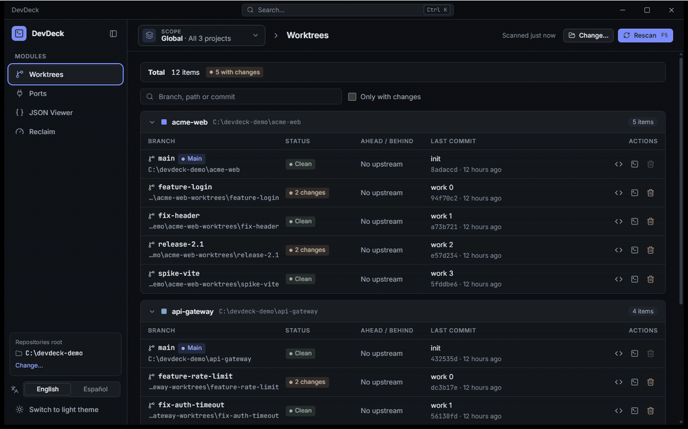
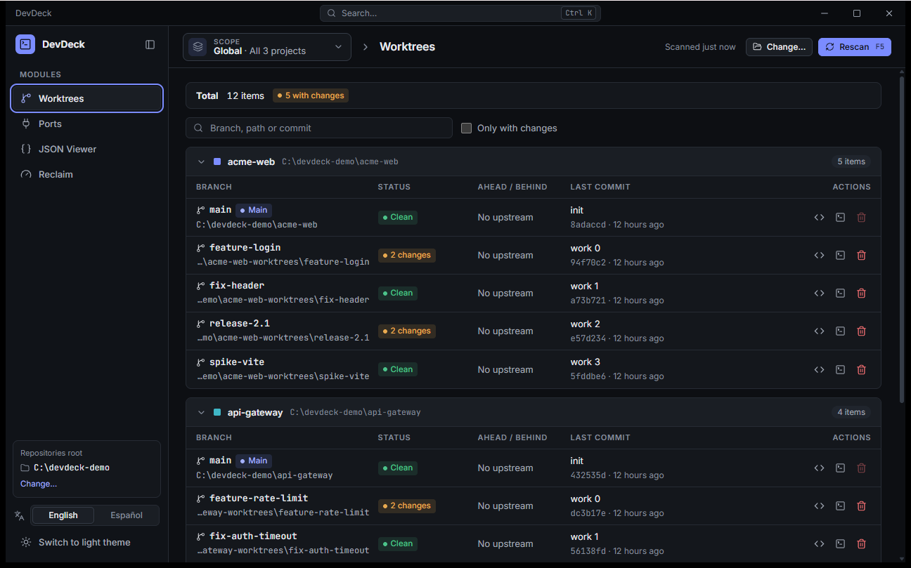
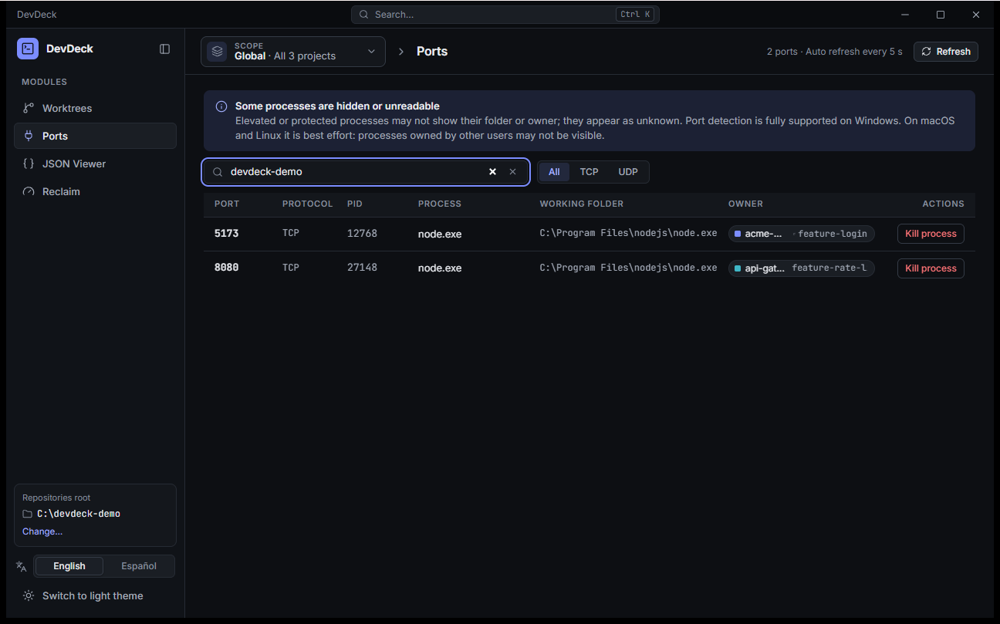
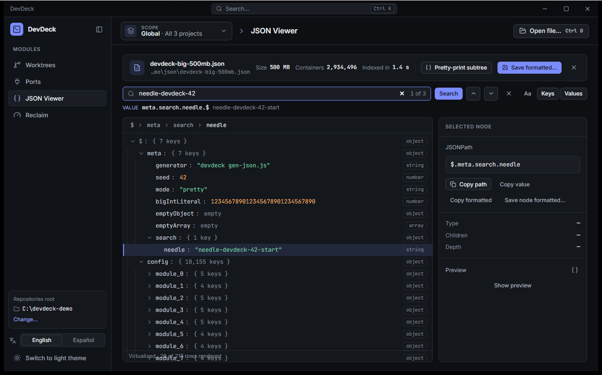
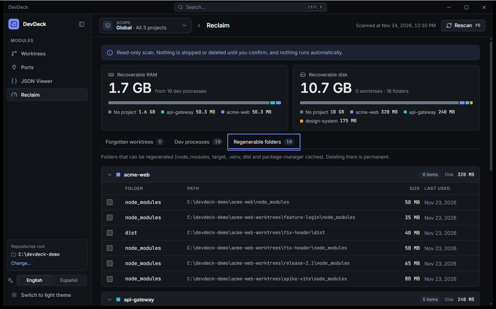
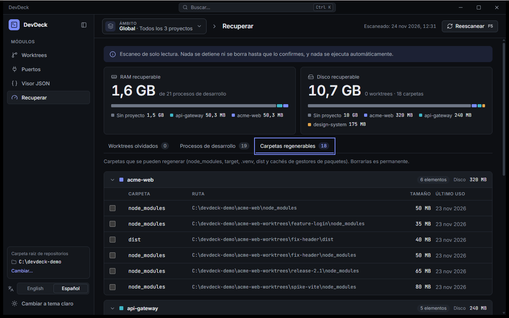
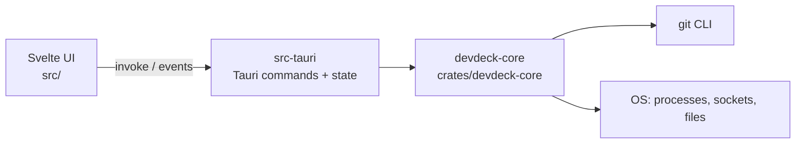

# DevDeck

[](https://github.com/frxncismor/devdeck/actions/workflows/ci.yml)
[](https://github.com/frxncismor/devdeck/actions/workflows/secret-scan.yml)
[](https://github.com/frxncismor/devdeck/actions/workflows/release.yml)
[](LICENSE)

A Tauri 2 + Rust desktop dashboard for developers: track git worktrees, see which worktree owns each listening port, browse multi-hundred-MB JSON files, and reclaim disk and RAM from forgotten worktrees and orphaned dev processes.



## What it does

DevDeck is a single window with four modules in a collapsible sidebar, a custom title bar with a command palette (**Ctrl K**), a **dark / light theme** switch, a **Global / project scope selector** and an **English / Spanish language selector**. Everything is read-only until you confirm an action; nothing runs on its own. Long actions (remove a worktree, terminate a process, delete folders, rescan) run in the background: the rest of the UI stays usable, the affected row or button shows a spinner (deleting several folders also shows per-folder progress, e.g. "Deleting 2 of 3 · 1.4 GB freed"), and a toast reports the result. The **?** button in the top bar of Worktrees, Reclaim and Ports opens the [Glossary](#glossary) inside the app.

Keyboard shortcuts: **Ctrl K** command palette, **Ctrl B** collapse the sidebar, **Ctrl P** scope selector, **Ctrl O** open a JSON file (JSON Viewer), **F5** rescan or refresh (Worktrees, Reclaim).

### Worktrees

Point DevDeck at a root folder and it finds every git repo and lists all of its worktrees: branch, whether it has uncommitted changes ("No uncommitted changes" or "N changed files"), how it compares with its remote branch (in sync, ahead, behind or diverged), and the last commit. Every status has a tooltip; see the [Glossary](#glossary). Open a worktree in VS Code or a terminal, or remove a linked worktree (with confirmation; dirty worktrees need a stronger one).



### Ports

Lists listening TCP ports (UDP optional) with PID, process name and executable path, and attributes each process to the worktree or project its working directory lives in. Search by port, PID, name, path or project; kill a process after confirming; refresh manually or automatically.



### JSON Viewer

Opens JSON files of several hundred MB without loading them into the webview. The file is indexed in one streaming pass in the background (with progress and cancellation); the tree is virtualized and children are fetched on demand. Search keys and values, copy a node's path (`$.a.b[3]`), copy or save a formatted subtree, or save the whole file formatted. Invalid JSON is reported with its offset.



### Reclaim

Shows how much RAM and disk you can recover, in the current scope:

- **Forgotten worktrees** - size, last-commit age, branches that are merged or have no uncommitted changes, and live processes inside; removable with confirmation.
- **Dev processes** - node, vite, cargo, rust-analyzer, headless browsers, Docker and similar, with RAM, CPU and age. Processes whose working directory is in a deleted worktree are flagged as orphaned.
- **Regenerable folders** - `node_modules`, `target`, `.venv`, `dist` and package-manager caches, with size and last use. The backend rejects any path that is not on the allow-list.



## Glossary

Every label DevDeck shows, with its exact English text. In the app, the **?** button in the top bar of Worktrees, Reclaim and Ports opens the same list. Counts in the examples are samples.

### Worktrees

| Term                   | Meaning                                                                                                              | What to do                                                                           |
| ---------------------- | -------------------------------------------------------------------------------------------------------------------- | ------------------------------------------------------------------------------------ |
| No uncommitted changes | Every change in this worktree is already committed.                                                                  | Nothing to do. This worktree is safe to switch away from or remove.                  |
| 3 changed files        | Files modified, added or deleted that are not committed yet. Commit or stash them before removing the worktree.      | Commit or stash the changes before removing the worktree; removing it discards them. |
| Missing folder         | The folder of this worktree no longer exists on disk, but git still lists it. Run git worktree prune to clean it up. | Run `git worktree prune` in the repository to forget it.                             |
| Main                   | The original checkout of the repository. It cannot be removed from here.                                             | Nothing: it is the repository itself. Remove extra worktrees instead.                |
| Detached HEAD          | Not on any branch: commits made here can get lost. Switch to or create a branch to keep them.                        | Create or switch to a branch (`git switch -c name`) before committing more.          |
| No remote branch       | This branch has no remote counterpart to compare with. Push it to publish it.                                        | Push the branch (`git push -u origin <branch>`) when you want to publish it.         |
| In sync                | Up to date with its remote branch.                                                                                   | Nothing to do.                                                                       |
| ↑ Ahead                | 2 commits not pushed yet. Push to share them.                                                                        | Push to share your commits.                                                          |
| ↓ Behind               | 2 commits on the remote that you do not have yet. Pull to get them.                                                  | Pull (or fetch and merge) to get them.                                               |
| ↑↓ Diverged            | Not pushed: 1 · To pull: 2. The local and remote branches have diverged.                                             | Pull or rebase first, then push.                                                     |

### Reclaim

| Term                   | Meaning                                                                                                                     | What to do                                                                               |
| ---------------------- | --------------------------------------------------------------------------------------------------------------------------- | ---------------------------------------------------------------------------------------- |
| No recent commits      | No commits for the configured number of days or more, so it is probably forgotten.                                          | Review it; remove the worktree if the work is finished.                                  |
| Branch merged          | Its branch is already merged into the base branch, so removing the worktree loses no work.                                  | Safe to remove: the work is already in the base branch.                                  |
| No uncommitted changes | Nothing is uncommitted: removing it will not discard any local edits.                                                       | Nothing would be lost by removing it.                                                    |
| Processes running      | Processes are running inside this folder; removing it may interrupt them.                                                   | Terminate those processes in the Processes tab first, or accept they may be interrupted. |
| Deleted worktree       | Working directory no longer exists.                                                                                         | Terminate it: it keeps memory for a folder that is gone.                                 |
| Regenerable folders    | Folders that can be regenerated (node_modules, target, .venv, dist and package-manager caches). Deleting them is permanent. | Delete them to free disk; the tool recreates them when needed.                           |

### Ports

| Term       | Meaning                                                              | What to do                                                                           |
| ---------- | -------------------------------------------------------------------- | ------------------------------------------------------------------------------------ |
| Unknown    | The folder is not readable (protected or elevated process).          | Run DevDeck as administrator to see its folder, or identify it by PID.               |
| No project | The folder of this process is not inside any of your known projects. | Nothing: it is not part of your known projects. Check its folder before terminating. |

## Language support

The UI ships in English (default) and Spanish. Switching is instant, persisted, and also changes date, number and size formatting. A test fails if the two locale files differ in keys or placeholders.

<p>
  
  
</p>

## Tech stack

- **Shell:** [Tauri 2](https://tauri.app/) (Rust), WebView2 on Windows
- **Frontend:** Svelte 5, TypeScript, Vite, Vitest
- **Backend:** Rust workspace, `sysinfo`, `listeners`, `memmap2`, `walkdir`
- **Tooling:** pnpm, ESLint, Prettier, svelte-check, clippy, rustfmt, gitleaks

## Architecture



- `crates/devdeck-core` holds all logic (worktrees, ports, JSON viewer, reclaim, project/scope attribution) with no Tauri dependency, so it is unit-tested directly. System access sits behind small traits and is simulated in tests.
- `src-tauri` is a thin layer: Tauri commands, app state, a typed error type, and the `store`, `dialog`, `clipboard-manager` and `opener` plugins.
- `src/` is the Svelte frontend, one folder per module under `src/modules/`, with translations in `src/lib/i18n/locales/{en,es}`.
- The backend never sends UI text. Errors carry a stable `kind` and `code`, and the frontend translates them.
- Large JSON files are indexed once by streaming; the frontend only ever receives paginated children and search batches.

## Install

Download the latest installer from [GitHub Releases](https://github.com/frxncismor/devdeck/releases):

- `DevDeck_0.1.0_x64_en-US.msi` (Windows Installer), or
- `DevDeck_0.1.0_x64-setup.exe` (NSIS)

The installers are **not code-signed**, so Windows SmartScreen may show an "unknown publisher" warning. Choose **More info -> Run anyway** if you trust the download.

## Platform notes

- **Windows** is the supported platform: installers are built and the terminal action (`wt`, falling back to `pwsh`/`cmd`) targets Windows.
- **macOS / Linux**: CI builds, lints and tests on both, and the Ports module uses a cross-platform socket library, but it is best effort only and not guaranteed. No installers are published for them.

## Development

Requirements: Node.js 22 and pnpm, the Rust stable toolchain (pinned via `rust-toolchain.toml`, with rustfmt and clippy), `git`, and [WebView2](https://developer.microsoft.com/microsoft-edge/webview2/) on Windows. On Linux, install the Tauri system dependencies (see the [Tauri prerequisites](https://tauri.app/start/prerequisites/)).

```sh
pnpm install
pnpm setup:hooks      # use .githooks (gitleaks pre-commit)
pnpm setup:gitleaks   # download the pinned gitleaks 8.30.1 (SHA-256 verified)
pnpm tauri dev        # run the app
```

Checks (the same ones CI runs):

```sh
cargo fmt --all --check
cargo clippy --workspace --all-targets -- -D warnings
cargo test --workspace
pnpm lint
pnpm check
pnpm test
pnpm test:scripts
```

Build the installers with `pnpm tauri build` (bundles: MSI and NSIS).

## CI and release

- **CI** (`.github/workflows/ci.yml`) runs on pull requests and pushes to `main`, on Windows, macOS and Ubuntu: frontend build, `cargo fmt`, `clippy -D warnings`, `cargo test`, `pnpm lint`, `pnpm check`, `pnpm test` and `pnpm test:scripts`.
- **Secret scan** (`.github/workflows/secret-scan.yml`) runs gitleaks over each PR or push commit range.
- **Release** (`.github/workflows/release.yml`): pushing a tag matching `v*` builds on Windows with `tauri-action` and creates a **draft** GitHub release with the `.msi` and NSIS `.exe`.

## Security

- A `pre-commit` hook runs a pinned gitleaks (8.30.1) on staged changes and fails closed if it is missing, has the wrong version, or the tool path is a symlink. The setup script verifies the download's SHA-256.
- CI repeats the scan over the full commit range.
- Tauri capabilities are minimal: only the dialog and clipboard-write permissions the frontend uses, plus opening one URL (the author credit) in the system browser; no shell access. A strict CSP is set.
- Destructive actions always require confirmation. The backend validates paths: worktree actions only accept known worktrees, the main worktree cannot be removed, and folder deletion only accepts allow-listed names.

## Screenshots

The images in `docs/img/` are captured from the release build (dark theme) against throwaway demo data, so no real project, path or process shows up. To regenerate them (Windows):

1. Create the demo data: three small git repos with linked worktrees and regenerable folders under `C:\devdeck-demo` (`gen-demo.ps1`), and a large anonymous JSON file (`node gen-json.js <out.json>`, about 130 MB).
2. Start one or two demo servers with their working directory inside a demo worktree, for example `node -e "require('http').createServer().listen(5173)"`, and point the DevDeck root folder at `C:\devdeck-demo` (Global scope, English).
3. Install the release build and run the UI Automation script (`capture-t095.ps1`): it opens DevDeck once, clicks through each module and language, and saves every window with `PrintWindow`.
4. Optimize the PNGs with `magick <in>.png -strip -define png:compression-level=9 <out>.png`.
5. Build `docs/img/demo.gif` with ffmpeg: scale the frames to about 1100 px wide, cross-fade them with `xfade`, and use a two-pass palette (`palettegen` + `paletteuse`) to keep it under 5 MB.

The scripts are kept with the development notes, not in this repository.

## Contributing

Contributions are welcome. Read [CONTRIBUTING.md](CONTRIBUTING.md) and the [Code of Conduct](CODE_OF_CONDUCT.md); report vulnerabilities privately as described in [SECURITY.md](SECURITY.md). To get started, look for [good first issues](https://github.com/frxncismor/devdeck/issues?q=is%3Aopen+label%3A%22good+first+issue%22).

## License

[MIT](LICENSE) - (c) 2026 Francisco J. Moreno

Made by [@frxncismor](https://github.com/frxncismor)
